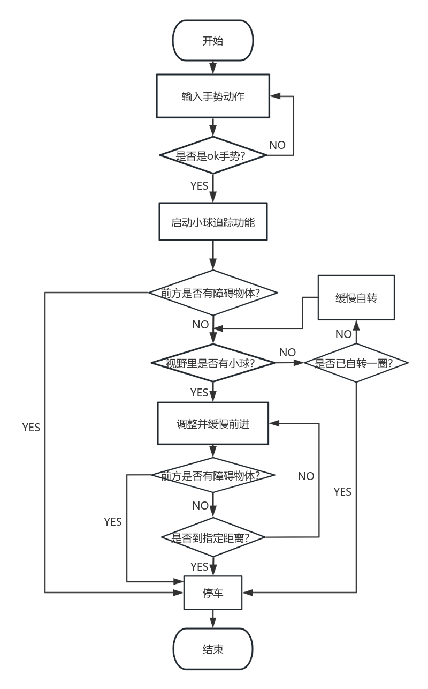
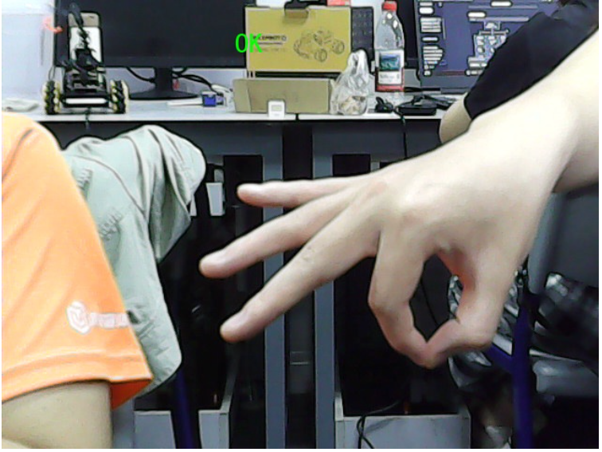
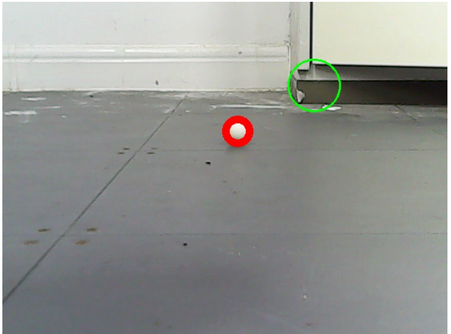
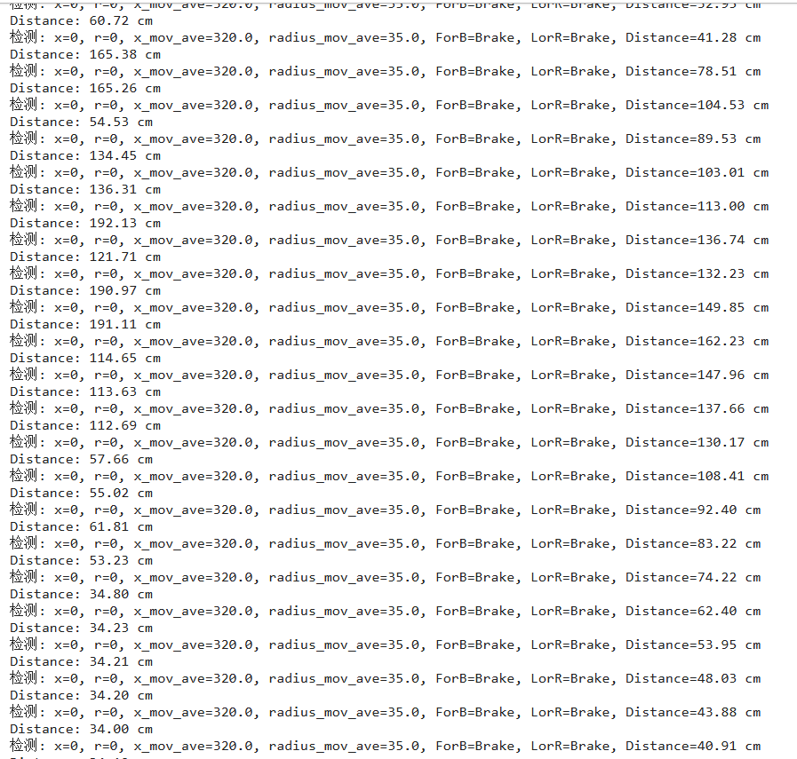
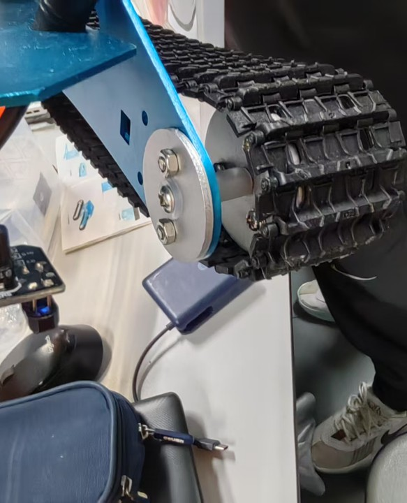

# 树莓派小车小球追踪系统的设计与实现

计算机工程实践项目，参考了 [Mingrui-Yu/RaspberryCar](https://github.com/Mingrui-Yu/RaspberryCar/tree/master) 的实现。

开发目标：小车能识别球并自动跟踪，直到球停止。在识别追踪过程中，允许移动小球。使用超音波传感器避障，若小球进入缝隙，自动停止。可通过手势启动该系统。

## 系统环境

小车端：亚博 G1 履带坦克，Raspberry Pi 4B + Python 3.9

电脑端：Windows NT 10.0.19045，在网页版 Jupyter Notebook 上操作

>py -m pip install baidu-aip demjson ipywidgets "notebook<=7.5.7"

## 功能特色

舵机细操作，少量多次调方向，保障稳定性和降噪；滤波精准度动态调整，根据横纵运动特性设定不同速度，实现对小球的精准、稳定追踪。即使在小球快速移动或偶尔丢失视野的情况下，也能迅速重新定位并继续追踪。

接入百度 Pygame API，无需额外的遥控设备，用户通过简单的 OK 手势即可控制小车的小球追踪功能，提升了用户体验和操作便捷性。

## 程序逻辑



手势识别基于百度大脑 AipBodyAnalysis API 实现。通过摄像头获取图像后，将图像数据发送至百度 API 服务器，利用其预训练的深度学习模型进行手势识别。模型可识别多种常见手势，返回手势类别信息。系统根据返回结果判断是否为预设的启动/停止手势，进而控制小车的小球追踪功能。



相比 RGB，HSV（色调、饱和度、明度）更适合颜色过滤。白色网球的 HSV 范围设定为 \[0, 0, 220\] 到 \[180, 30, 255\]，聚焦高亮度、低饱和度区域。



模块发射超声波脉冲，遇障碍物反射，传感器接收反射波。根据发射与接收的时间差和声速计算距离。当距离小于设定阈值时，触发避障机制，控制小车停止前进，防止碰撞。



## 技术门槛

```
初级故障：摄像头不能操控、损坏的蓝牙功能、编程语言更换后不执行操作

进阶故障：把各种轮廓识别成圆、百米冲刺、终端 Python 和 Jupyter 所调用的库中方法冲突

超级故障：实时摄像的超长延迟、轮毂隔离柱被恶意削短、停止指令无响应
```

机械方面。一是查到 C++ 和 Python 的运动接口不同。二是用圆铁钉套上轮轴，再用黑胶带缠住结合点，让螺丝不再松动。三是从不稳定的蓝牙固件改用路由器功能。



识别方面，在某些光照条件下，小车容易受到背景颜色干扰。对小球颜色的 HSV 范围进行了多次调整和优化，同时采用自适应的图像增强算法，改善图像质量，提高小球识别的准确性和稳定性。

实时摄像方面。通过 VNC 远程连接，避免浏览器占用过多内存资源。小车运行逻辑在树莓派本地执行，实现摄像和控制分离，脱离 Jupyter Notebook 对代码自动分析和内网摄像界面的多重依赖。

自动避障方面。一是同小球保持一定距离，不让小球超越原本位置。二是遇到障碍自动停止，不因小球的运动而冲撞墙面。

## 局限性

摄像延迟的根本原因是摄像头过热。该项目采用的技术方案大量依赖摄像头。

这批小车已经被用了四年，同一批购买的 4WD 小车大量报废，一些更高级的机器狗缺乏 stm32 相关技术资料。